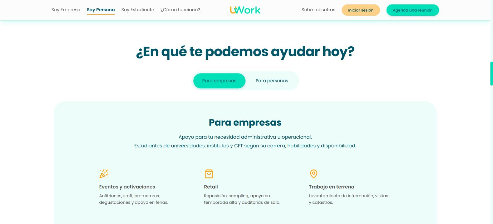

# UWork — talento universitario para trabajos a tu medida

UWork conecta a estudiantes de educación superior con oportunidades de trabajo flexible y ayuda a empresas y personas a encontrar apoyo para tareas, turnos y proyectos. Este repositorio contiene el sitio web de presentación, desarrollado con Astro, React y Tailwind CSS.

## Vista previa

| Inicio                                        | Servicios                                                         |
| --------------------------------------------- | ----------------------------------------------------------------- |
|  |  |


## Demo en vivo

[Ver UWork](https://eduardoes99.github.io/UWork.cl/)

## Acerca del proyecto

El sitio presenta las soluciones para empresas y personas, explica el proceso de publicación y coordinación de trabajos y ofrece una página dedicada a estudiantes. Incluye perfiles interactivos, servicios, testimonios, preguntas frecuentes y formularios de contacto, inicio de sesión y registro.

Los formularios y las pantallas de acceso funcionan como una experiencia visual local: no hay backend, cuentas reales ni envío de solicitudes. Los testimonios, perfiles y cifras forman parte del contenido de presentación.

## Características principales

- Portada con carrusel de perfiles estudiantiles y secciones para empresas y personas.
- Proceso interactivo, indicadores animados y testimonios.
- Página para estudiantes con beneficios, pasos de participación y preguntas frecuentes.
- Páginas independientes de inicio de sesión y registro.
- Diseño adaptable a escritorio y móvil, con animaciones y controles interactivos.

## Tecnologías

- Astro 7 para páginas y generación estática.
- React 19 para componentes interactivos.
- Tailwind CSS 4 para estilos.
- Swiper y Lucide para carrusel e iconos.
- pnpm para dependencias.

## Estructura

```text
src/
├── assets/       # Imágenes, logos, iconos y fuentes
├── components/   # Secciones, formularios y componentes de interfaz
├── layouts/      # Layout principal y de autenticación
├── lib/          # Rutas y utilidades compartidas
├── pages/        # Inicio, estudiantes, acceso y registro
└── styles/       # Estilos globales y específicos
public/previews/  # Capturas usadas en este README
```

## Desarrollo local

Requiere Node.js 22.22 o superior y pnpm.

```bash
pnpm install
pnpm dev
```

Abre `http://localhost:4321/`. Para comprobar el proyecto, ejecuta `pnpm check`. La exportación para GitHub Pages se genera con `pnpm build --base /UWork.cl/` y se publica desde la raíz de la rama `gh-pages`.
